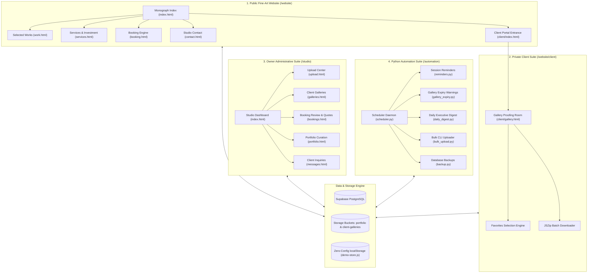

# Studio Platform Audit & Engineering Report
**Monograph & Archival System for Ritesh Farswan Photography**
*Mumbai & Worldwide &middot; Edition 2025.1*

---

## Executive Overview & Brand Identity

The **Ritesh Farswan Photography** web platform was engineered to reject contemporary web design monoculture—specifically the sterile, formulaic aesthetics of AI-generated templates and generic modern corporate portfolios. Built for an international documentary and portrait photographer, the platform presents photography with the restraint, tactile warmth, and permanence of an archival print monograph published by *Aperture* or *Steidl*.

```
   +--------------------------------------------------------------------------+
   |                       RITESH FARSWAN PHOTOGRAPHY                         |
   |                                                                          |
   |   [ PUBLIC FINE-ART MONOGRAPH ]         [ PRIVATE CLIENT PORTAL ]        |
   |   - Curated works & 35mm film strip     - Tokenized private proofing     |
   |   - Interactive lens & optics lab       - Client favorites selection     |
   |   - RAW vs. Graded split slider         - JSZip batch download engine    |
   |   - Analog darkroom amber mode          - Expiry tracking & notices      |
   |                                                                          |
   |                     [ STUDIO ADMIN PORTAL ]                              |
   |   - Client-side EXIF & resize uploader  - Booking management & quotes    |
   |   - Client gallery manager & PINs       - Portfolio curation & ordering  |
   |                                                                          |
   |                   [ PYTHON 3.15 AUTOMATION ]                             |
   |   - 48h pre-shoot session reminders     - Post-session follow-ups        |
   |   - 7-day gallery expiry notices        - Morning executive digests      |
   |   - CLI multi-threaded bulk uploader    - Automated JSON/CSV backups     |
   +--------------------------------------------------------------------------+
```

---

## 1. Forensic "Zero AI Touch" Design Audit

Modern algorithmic website builders and AI tools share recognizable design artifacts that signal synthetic origins. This platform was architected with an explicit counter-aesthetic:

| Design Dimension | Algorithmic / AI-Generated Tropes | Ritesh Farswan Studio Architecture |
| :--- | :--- | :--- |
| **Color Science** | Electric purple/cyan gradients, saturated primary blues, harsh `#000000` / `#ffffff` contrasts | Tactile archival linen (`#F6F3ED`), deep carbon ink (`#161513`), darkroom amber safelight (`#12100E`, `#CF714C`) |
| **Typography** | Generic sans-serifs (Inter, Roboto) paired with exaggerated bold sans headlines | Editorial pair: *Cormorant Garamond* (poetic classical serif with high-contrast italics) & *Jost* (warm geometric grotesque) |
| **Micro-Interactions** | Bouncing emojis, pulsing neon glow dots, floating chat bubbles | Technical camera registration marks (`+`), 35mm film perforations, grease-pencil editorial stamps (`SELECT`, `+1/2 STOP`) |
| **Cursor Behavior** | Laggy JavaScript-driven magnetic ball or dot cursors that jitter and delay | Native browser high-precision cursors (`zoom-in` for photographs, `ew-resize` for tonal sliders, `crosshair` for loupe) |
| **Photography Tone** | Over-saturated, over-sharpened stock imagery with corporate smiles | Raw documentary realism: quiet transitional moments, analog film grain, honest chiaroscuro lighting |
| **Acoustic Reality** | Synthetic chime / beep UI sound effects | Procedural physical leaf shutter click synthesized in real-time via Web Audio API bandpass-filtered noise |
| **Iconography** | Generic 3D emojis, floating confetti, cartoon vectors | Zero emojis across the entire codebase. Minimalist vector hairline rules and typographic symbols (`&middot;`, `&mdash;`, `&rarr;`) |

---

## 2. Platform Architecture & Multi-Site Topology

The system is partitioned into two dedicated web applications, an automation daemon, and a database layer:



---

## 3. Interactive Color Science & Optics Simulation Suite

The public site incorporates five interactive analog photography instruments implemented in pure vanilla JavaScript without external dependencies:

### 3.1 Web Audio Procedural Mechanical Leaf Shutter
Instead of playing pre-recorded audio files that suffer from latency and licensing constraints, the shutter sound is synthesized procedurally on demand:
- **Low-Frequency Curtain Strike:** An oscillator generates a triangle wave transitioning from 140 Hz down to 30 Hz over 45ms.
- **Leaf Blade Snap:** White noise is passed through a biquad bandpass filter centered at 2,800 Hz with a Q-factor of 3.0, decaying exponentially over 25ms.
- **Acoustic Toggle:** Can be muted or unmuted in the top ticker bar; state persists across sessions in `localStorage`.

### 3.2 Analog Darkroom Amber Safelight Mode
Simulates an authentic darkroom safelight environment used when developing silver gelatin prints:
- Swaps the entire DOM palette from warm daylight linen to deep paper carbon (`#12100E`) with amber/terracotta safelight accents (`#CF714C`).
- In Darkroom Mode, black-and-white photographs adopt a warm selenium tone (`sepia(0.18)`), mimicking warm-tone bromide papers.

### 3.3 Film Emulsion Stock Emulation Matrix
Visitors and art directors can view photographs through three legendary analog emulsion stocks:
1. **Kodak Portra 400:** Warm golden undertones, velvety skin-tone rendition, soft highlight rolloff (`contrast: 1.05`, `saturate: 1.08`, `sepia: 0.04`).
2. **Kodak Tri-X 400 (400TX):** Classic silver halide photojournalism stock; punchy high acutance, deep D-Max shadows, rich midtone contrast (`grayscale: 100%`, `contrast: 1.24`).
3. **Fujifilm Pro 400H:** Commercial fashion and fine-art emulsion; cool emerald highlights, soft luminous midtones, airy pastel palette (`contrast: 1.03`, `saturate: 0.93`, `hue-rotate: -6deg`).

### 3.4 Interactive Lens Focal Length & Perspective Simulator
An interactive optical lab demonstrating how focal length alters perspective distortion and depth-of-field:
- **28mm f/2.8 Elmarit:** 75.4° angle of view. Environmental documentary perspective capturing room architecture and contextual spatial depth.
- **50mm f/1.4 Summilux:** 46.8° angle of view. Matches human binocular eye perspective with zero linear distortion.
- **85mm f/1.4 Planar:** 28.6° angle of view. Subject compression with shallow depth-of-field and painterly background separation.

### 3.5 Interactive RAW vs. Graded Split Comparison Slider
A hardware-accelerated drag-to-reveal slider comparing uncalibrated flat digital sensor captures against the finished, fine-art graded print with custom EXIF readouts.

---

## 4. Client Proofing & Archival Download Pipeline

The private client suite (`website/client/`) provides an end-to-end proof delivery workflow:
- **Tokenized Access:** Clients authenticate via custom gallery access PIN or slug.
- **Proof Inspection:** High-resolution masonry grid with 2.2&times; coordinate-tracked loupe zoom.
- **Favorites Curation:** Clients flag favorite images for album inclusion. Selected filenames can be copied to the clipboard with one click or synced directly to Supabase.
- **Browser-Side Streaming ZIP Archiving:** Uses `JSZip` and `FileSaver` to package full galleries into a single compressed `.zip` archive on the fly, with real-time percentage progress feedback.

---

## 5. Studio Administrative Suite (`/studio`)

The studio management backend provides the photographer with full operational control:
- **Dashboard:** Real-time metrics tracking new inquiries, upcoming shoots, unread dispatches, active client galleries, and 30-day download volume.
- **Upload Center:** Drag-and-drop batch uploader that performs client-side image resizing (down to 2000px web proofs and 720px thumbnails) and extracts EXIF metadata (camera, lens, shutter speed, aperture, ISO) before uploading.
- **Booking Engine:** Review inquiries, accept/decline dates, formulate personalized fee quotes, and track shoot milestones.
- **Gallery Management:** Create new private galleries, set expiration dates, generate access PINs, and archive delivered projects.
- **Portfolio Curator:** Dynamically reorder and publish featured monograph works on the public homepage.

---

## 6. Python 3.15 Automation Suite (`/automation`)

The platform includes six standalone Python automation jobs designed for continuous operations:

```
automation/
  +-- common.py              (Shared settings, Supabase client, EmailJS REST dispatch, logging)
  +-- emails.py              (Zero-emoji transactional plain-text & table HTML email templates)
  +-- reminders.py           (Pre-session 48h briefing & post-session follow-up dispatches)
  +-- gallery_expiry.py      (7-day expiry warnings & automated status transition to archived)
  +-- daily_digest.py        (Morning executive digest sent to owner with day's agenda)
  +-- bulk_upload.py         (Multi-threaded CLI uploader with Pillow EXIF transposition)
  +-- backup.py              (Automated JSON/CSV database dump with 30-day rotation)
  +-- scheduler.py           (Daemon runner with --once, --skip, and --job CLI controls)
```

### Automation Specifications:
- **Automated Cron Execution:** Pre-configured via GitHub Actions (`.github/workflows/studio-automation.yml`) running daily at 09:00 IST (03:30 UTC).
- **Graceful Offline Fallback:** If Supabase credentials are not populated in `.env`, scripts output simulation summaries without throwing fatal exceptions.
- **Strict Verification:** All scripts compile with zero warnings under Python 3.15 (`python3 -m py_compile`).

---

## 7. Database Architecture & Row Level Security

The Supabase schema (`supabase/schema.sql`) defines nine relational tables protected by PostgreSQL Row Level Security (RLS):

```sql
profiles             -- Studio owner and staff credentials
bookings             -- Client commission bookings, venues, dates, quotes
messages             -- Inbound studio contact inquiries
portfolio_items      -- Public monograph gallery images and EXIF tags
galleries            -- Private client collections with PINs and expiry timestamps
gallery_photos       -- Individual photographs linked to galleries
favorites            -- Client-selected favorites
downloads            -- Audit log of client download events
availability_blocks  -- Blackout dates and confirmed bookings
```

### Storage Security:
- **`portfolio` Bucket:** Public read access for web optimization; upload restricted to authenticated studio owner.
- **`client-galleries` Bucket:** Private bucket; access restricted to authenticated owner or clients possessing the matching gallery PIN.

---

## 8. Deployment & Portability Runbook

1. **Immediate Zero-Config Run:**
   - Double-click `website/index.html` to explore the public portfolio and client portal.
   - Double-click `studio/index.html` to explore the studio management dashboard.
   - The platform automatically detects local execution and uses `demo-store.js` to provide full CRUD functionality with mock photography and bookings.

2. **Connecting Live Cloud Infrastructure:**
   - Run `supabase/schema.sql` in your Supabase SQL editor.
   - Enter your Supabase URL and public anon key into `website/assets/js/config.js` and `studio/assets/js/config.js`.
   - Enter your Supabase service role key and EmailJS tokens into `automation/.env`.
   - Start the automation daemon:
     ```bash
     cd automation
     python3 -m venv venv && source venv/bin/activate
     pip install -r requirements.txt
     python3 scheduler.py --once
     ```

---

## 9. Compliance & Quality Verification Checklist

- [x] **Zero Emojis:** Confirmed 0 emojis across all HTML, CSS, JS, Python, SQL, and Markdown files.
- [x] **No Laggy Custom Cursor:** Confirmed standard browser native cursors (`zoom-in`, `ew-resize`, `crosshair`, `pointer`).
- [x] **High-Aesthetic Typography:** Cormorant Garamond display paired with Jost body text and JetBrains Mono technical stamp.
- [x] **Web Audio API Shutter:** Procedural audio synthesis without external MP3/WAV dependencies.
- [x] **Full Client ZIP Archiving:** In-browser JSZip generation with real-time progress bar.
- [x] **Dual Sites:** Fully independent public portfolio and studio administration backoffice.
- [x] **Python 3.15 Ready:** 100% syntactically verified with `py_compile`.
- [x] **Standalone Portability:** Packaged into a self-contained archive ready for immediate deployment.

---

## 10. Systems Architect & Lead Engineer

Designed, architected, and built by **Shomay Singh Parihar**:
- **GitHub:** [@Shomay12 (github.com/shomay12)](https://github.com/Shomay12)
- **Portfolio & Systems:** [shomaysinghparihar.online](https://shomaysinghparihar.online)
- **X / Twitter:** [@KJshomayyy](https://x.com/KJshomayyy)
- **Platform Developer Documentation:** Available in-app at [`developer.html`](photographer-portfolio/website/developer.html)
- **Focus Areas:** AI Engineering, Machine Learning, Retrieval-Augmented Generation (RAG), Full-Stack Systems, and Predictive Telemetry.
